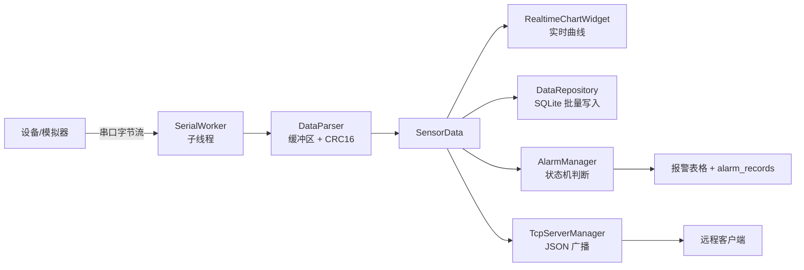
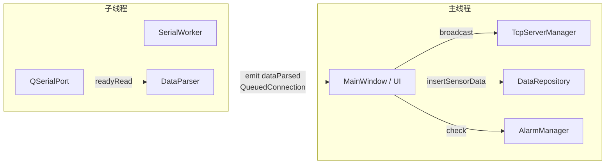

# IndustrialMonitor

IndustrialMonitor 是一个工业设备数据采集与监控上位机。支持串口采集、协议解析、实时曲线、SQLite 存储、阈值报警、TCP 远程监控，以及完整的异常处理与日志。项目使用Qt6 + C++14 + Visual Studio 2026 ，构建系统为 MSBuild。

## 功能

**串口与采集**

- 串口配置（端口刷新与选择、波特率、数据位、校验位、停止位）
- 子线程串口采集（`QThread` + `moveToThread`），主线程只做 UI，高频数据不卡
- 串口参数持久化，启动时自动恢复

**协议解析**

- 自定义二进制帧：[详情链接](./docs/protocol.md)
- 缓冲区处理粘包/半包，CRC 校验失败跳过无效帧，不阻塞后续数据

**实时曲线**

- Qt Charts 动态折线图，X 轴时间滚动，保留最近10秒的点
- 坐标轴降频更新（1秒刷新一次），高频数据下 UI 流畅

**存储与查询**

- 采集数据与报警记录写入 SQLite，批量事务提交放卡顿
- 历史查询按时间范围过滤，结果在UI的表格展示，支持导出 CSV

**阈值报警**

- 每个传感器独立配置阈值上下限和启用状态，通过对话框编辑，INI 持久化
- 状态机去重：只在“正常→超限”上升沿产生报警，持续超限不刷屏

**TCP 远程监控**

- 多客户端连接，实时数据以 JSON 广播
- 端口被占用时弹窗换端口，成功后写回配置
- 客户端异常断开自动清理，不崩溃

**日志与异常处理**

- 分级日志，控制台 + 文件双输出，`QMutex` 保证多线程安全
- 串口热插拔、TCP 客户端崩溃、数据库只读、INI 损坏均不崩溃

## 技术栈

| 类别  | 技术                                                  |
| --- | --------------------------------------------------- |
| 语言  | C++14                                               |
| 框架  | Qt 6（Widgets / SerialPort / Charts / Network / Sql） |
| IDE | Visual Studio 2026+ Qt VS Tools                     |
| 构建  | MSBuild（`.vcxproj`），VS 图形界面管理文件                     |
| 数据库 | SQLite（`QSqlDatabase` + `QSqlQuery`）                |
| 配置  | `QSettings`（INI 格式）                                 |
| 并发  | `QThread` + `moveToThread`，信号槽跨线程                   |
| 日志  | `qInstallMessageHandler` + `QMutex`                 |
| 协议  | 自定义二进制帧 + CRC16                                     |
| 测试  | Python 模拟器 / TCP 客户端，C++ 单元测试                       |

## 项目结构

```c++
IndustrialMonitor/
├── src/                    
│   ├── model/              数据模型 SensorData、Threshold、AlarmRecord
│   ├── core/               核心逻辑 DataParser、AlarmManager
│   ├── communication/      Tcp通信 TcpServerManager
│   ├── ui/widgets/         主窗口、串口&阈值配置面板 RealtimeChartWidget、SerialConfigWidget、AlarmSettingDialog
│   ├── storage/            存储层 DatabaseManager、DataRepository
│   ├── thread/             串口通信 SerialWorker
│   └── utils/              工具 Logger、ConfigManager
├── resources/              qrc、styles/app.qss
├── tools/                  device_simulator.py、tcp_client.py
├── docs/                   协议、截图
└── tests/                  单元测试
```

## 数据流



## 线程模型



## 构建与运行

### 环境要求

- Visual Studio 2026（含“使用 C++ 的桌面开发”）
- Qt 6.11.2（msvc2022_64），安装 Qt VS Tools 插件
- Python 3 + pyserial（仅模拟器需要）
- com0com（虚拟串口工具）

### 编译

1. 用 VS 打开 `IndustrialMonitor.slnx`
2. 确认 Qt VS Tools → Qt Versions 已配置 Qt 6.11.2
3. 选择 Debug / x64，按 `Ctrl+Shift+B` 生成
4. 按 `F5` 运行

### 运行串口模拟器

1. 用 com0com 创建虚拟串口对 `COM10` / `COM11`
2. 命令行运行：`python tools/device_simulator.py`
3. 上位机选择 `COM10`，波特率 `115200`，点击“打开串口”

### 运行TCP客户端模拟器

1. 上位机点击工具栏中的`启动远程监控`，若端口被占用，请在弹出的对话框里输入新端口。
2. 命令行运行：`python tools/tcp_client.py`

## 当前进度

【第一部分】串口配置、子线程采集数据、协议解析、实时曲线

【第二部分】SQLite 存储、历史数据查询界面、阈值报警、配置持久化、TCP远程监控、日志模块、异常处理

## 技术亮点

* **子线程串口采集**：`moveToThread` 把串口读写放到子线程，主线程只做 UI，每秒 100 条数据下不卡顿。

* **缓冲区处理粘包/半包**：`DataParser` 循环找帧头、判断长度、校验 CRC，模拟器任意拆分/合并发送都能正确解析。

* **报警状态机去重**：只在本条数据超阈值且处于“正常→超限”上升沿，才产生报警，持续超限 10 分钟只产生 1 条记录。

* **批量事务写入**：数据库攒多条数据，隔1秒批量提交，防止频繁写入数据库。

* **异常降级不崩溃**：串口拔插、TCP 客户端崩溃、数据库只读、INI 损坏均有处理，程序继续运行并提示用户。

* **配置持久化**：基于QSettings的INI格式，集中管理串口参数、报警阈值、TCP端口。读取失败时用默认值。
